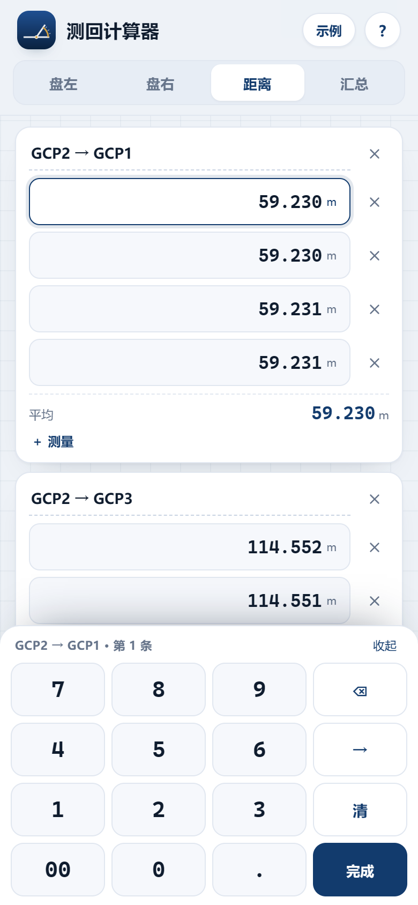

# 测回计算器 · 全站仪角度与距离平均

手机端网页应用（PWA）：三个模式（盘左 / 盘右 / 距离）+ 汇总，输入全部走底部数字键盘。点一下读数格子，按数字键连续输入，角值、平均实时出来。纯 HTML/CSS/JS，可离线、可添加到主屏幕。

[](https://github.com/Prqingyu/total-station-calc/actions/workflows/test.yml)

**在线使用：<https://prqingyu.github.io/total-station-calc/>**

<p>
  
  
  
</p>

## 怎么输入

- 点读数格子 → 底部键盘输入。
- **度**：按 → 跳到分（输入满 3 位也会自动跳）。
- **分、秒**：满 2 位自动跳到下一格；秒满 2 位自动到下一个读数。
- 一个读数只有 7 个数字左右，连续按键就能把整个盘左/盘右输完，不用反复点输入框。
- 距离：点距离格，输入数字和“.”，按 → 到下一条。

## 三个模式 + 汇总

| 模式 | 填什么 | 得到什么 |
| --- | --- | --- |
| **盘左** | 每个测回目标 A、B 的水平度盘读数 | 半测回角值、盘左平均 |
| **盘右** | 盘右读数（目标顺序与盘左一致） | 盘右平均 |
| **距离** | 按方向分组的水平距离 | 每个方向的平均距离 |
| **汇总** | 自动配对左右 | 一测回角值、各测回平均值、半测回/各测回互差 |

盘左、盘右可切换「读数 / 角值」：如果角值已经算好，直接输角值取平均。

## 计算公式

```
半测回角值  = (读数 B − 读数 A + 360°) mod 360°
一测回角值  = (盘左半测回 + 盘右半测回) ÷ 2
各测回平均值 = 各一测回角值的算术平均
距离均值    = 同一方向各次距离的算术平均
```

- 角度按 0.01″ 计算与显示（非整数秒保留两位小数）。
- 距离按「四舍六入五成双」取至毫米；距离模式显示到毫米。
- 汇总里的限差按 DJ6 常用指标着色（半测回互差 ≤ 40″，各测回互差 ≤ 24″），仅作提示。

## 与参考表格核对（GCP2）

点右上角「示例」可直接载入下表数据：

| 项目 | 第 1 测回 | 第 2 测回 | 平均 |
| --- | --- | --- | --- |
| 盘左半测回 | 125°14′18″ | 125°14′24″ | **125°14′21″** |
| 盘右半测回 | 125°14′24″ | 125°14′30″ | **125°14′27″** |
| 一测回 | 125°14′21″ | 125°14′27″ | **各测回平均 125°14′24″** |

距离：GCP2→GCP1 四条 59.230 / 59.230 / 59.231 / 59.231，均值 59.2305 → **59.230 m**；GCP2→GCP3 四条 114.552 / 114.551 / 114.553 / 114.553，均值 114.55225 → **114.552 m**。

> 参考表 GCP3 第 2 测回盘左 GCP4 读数写的是 150°28′54″，但同一行半测回角值 63°21′24″ 对应读数应为 153°28′54″；盘右 330°28′48″ 对应应为 333°28′48″。录入时以原始手簿为准。

## 手机安装

- **Android**：Chrome 打开在线地址 → 菜单 →「添加到主屏幕」。
- **iPhone**：Safari 打开 → 分享 →「添加到主屏幕」。

首次打开后应用会缓存，之后没有网络也能算。数据保存在本机浏览器（localStorage），刷新不丢。

## 本地运行与测试

```bash
npm install          # 仅用于测试（playwright-core）
npm test             # 计算核心单元测试（对参考表数值）
npm run serve        # http://127.0.0.1:8787/
node tests/e2e.mjs   # 无头 Edge 端到端测试（数字键盘输入）+ 截图
node tests/pwa.mjs   # 线上 PWA：离线、剪贴板、边界提示
node tools/screenshots.mjs
```

E2E 需要本机已安装 Microsoft Edge；可用环境变量 `EDGE_PATH` 指定浏览器路径，用 `BASE_URL` 指向线上地址做冒烟测试。

## 文件结构

```
index.html            页面、模式、键盘
style.css             移动端样式（含深色模式、安全区、键盘布局）
app.js                键盘输入、状态持久化、汇总与记录文本
calc.js               纯计算核心（角度 / 距离 / 四舍六入五成双）
sw.js                 Service Worker（离线缓存）
manifest.webmanifest  PWA 清单
icons/                应用图标
tests/                单元测试与端到端测试
tools/                本地静态服务器、图标生成、截图脚本
```

## License

MIT
