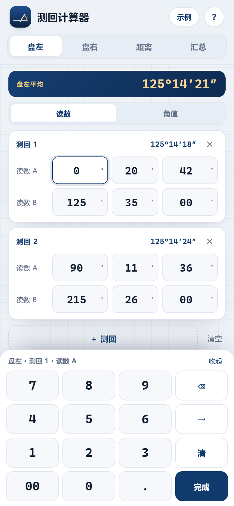
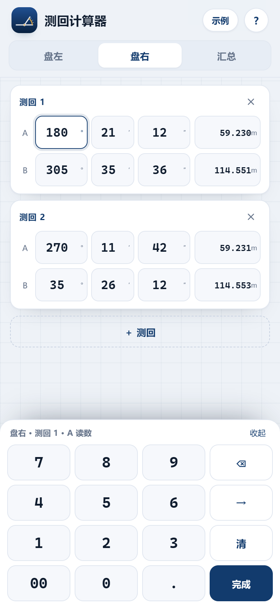
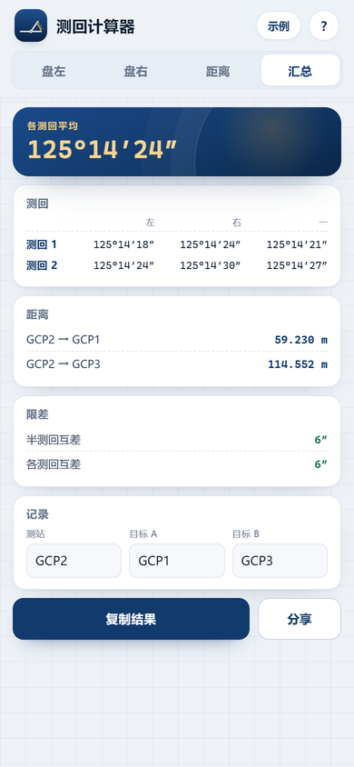

# 测回计算器 · 全站仪角度与距离平均

手机端网页应用（PWA）：**盘左 / 盘右 / 汇总** 三个选项卡。默认两个测回，只输读数，每个读数后面带一个水平距离框，底部数字键盘连续输入；汇总页给各测回平均角和水平距离。可离线、可添加到主屏幕。

[](https://github.com/Prqingyu/total-station-calc/actions/workflows/test.yml)

**在线使用：<https://prqingyu.github.io/total-station-calc/>**

<p>
  
  
  
</p>

## 结构

- **盘左**：两个测回（默认），每个测回有目标 A、B 的读数 A/B 和各自的距离框；每个测回标题右侧直接显示该盘的**半测回角值**。
- **盘右**：同样的两个测回，填盘右读数与距离；同样显示半测回角值。
- **汇总**：先列每个测回的**一测回角值**，再给**各测回平均角**，然后给 A/B 方向的水平距离均值，以及「新建测站」清空。

不再有距离选项卡和「角值」输入模式；只按读数录入。

## 输入

- 点读数格子或距离框，用底部数字键盘输入。
- **度**：满 3 位自动到分；1～2 位时按 `→` 到分。
- **分、秒**：满 2 位自动跳；秒满 2 位自动进入该读数的距离框。
- **距离**：输入数字和 `.`，按 `→` 到下一条读数。
- `⌫` 退格、`清` 清当前读数、`完成` 收起键盘；电脑可用物理键盘数字键。

## 计算

```
半测回角值   = (读数 B − 读数 A + 360°) mod 360°
一测回角值   = (盘左半测回 + 盘右半测回) ÷ 2
各测回平均值 = 各一测回角值的算术平均
水平距离均值 = 同一目标 A/B 在各盘、各测回中距离的算术平均
```

- 角度按 0.01″ 计算与显示。
- 距离按「四舍六入五成双」取至毫米。
- 不显示限差。

## 与参考表格核对（GCP2）

点右上角「示例」可载入：半测回角值 125°14′18″ / 125°14′24″（盘左）、125°14′24″ / 125°14′30″（盘右）；一测回 125°14′21″、125°14′27″；各测回平均 **125°14′24″**；A 方向 **59.230 m**，B 方向 **114.552 m**。

> 参考表 GCP3 第 2 测回盘左 GCP4 读数写作 150°28′54″，但同表角值 63°21′24″ 对应读数应为 153°28′54″（盘右 330°→333°）。录入以原始手簿为准。

## 手机安装

- **Android**：Chrome 打开在线地址 → 菜单 →「添加到主屏幕」。
- **iPhone**：Safari 打开 → 分享 →「添加到主屏幕」。

首次打开后应用会缓存，之后没有网络也能算；数据保存在本机浏览器。

## 本地运行与测试

```bash
npm install
npm test             # 计算核心单元测试
npm run serve        # http://127.0.0.1:8787/
node tests/e2e.mjs   # 无头 Edge 端到端测试 + 截图
node tests/pwa.mjs   # 线上 PWA / 离线测试
node tools/screenshots.mjs
```

E2E 需要本机安装 Microsoft Edge；可用 `EDGE_PATH` 指定浏览器路径，用 `BASE_URL` 指向线上地址做冒烟测试。

## 文件结构

```
index.html            页面、盘左/盘右/汇总、键盘
style.css             移动端样式（深色模式、安全区、键盘）
app.js                键盘输入、状态持久化、汇总、新建测站
calc.js               纯计算核心（角度 / 距离 / 四舍六入五成双）
sw.js                 Service Worker（离线缓存）
manifest.webmanifest  PWA 清单
icons/                应用图标
tests/                单元测试与端到端测试
tools/                本地服务器、图标、截图脚本
```

## License

MIT
